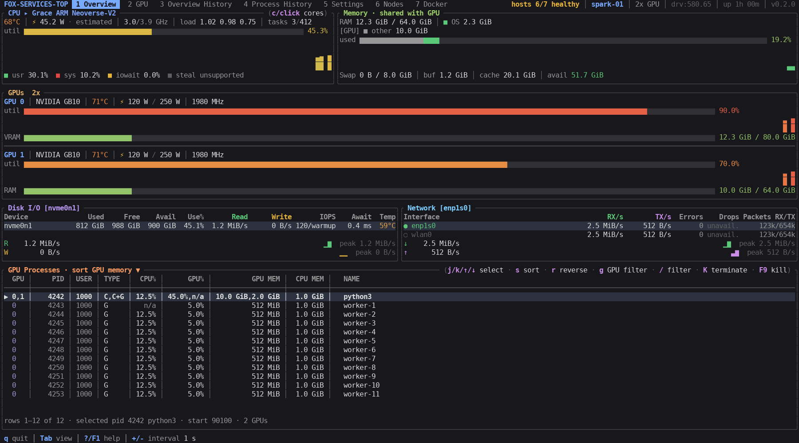
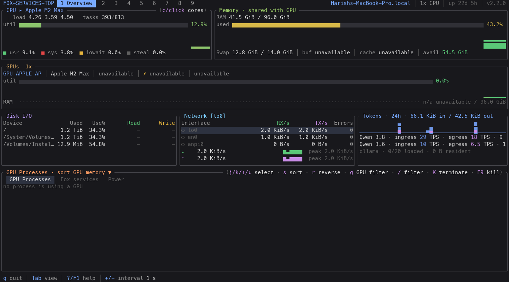
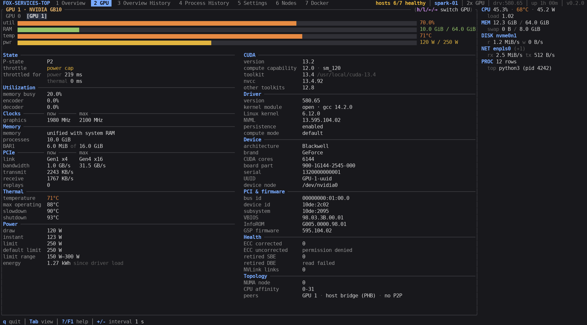
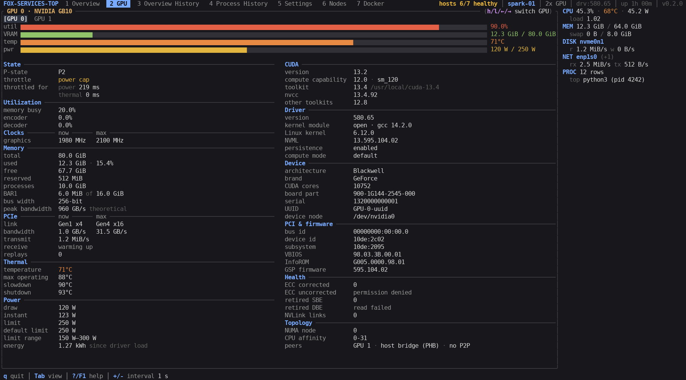
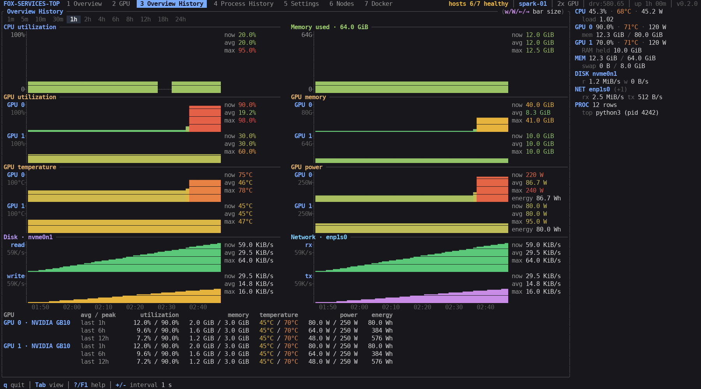
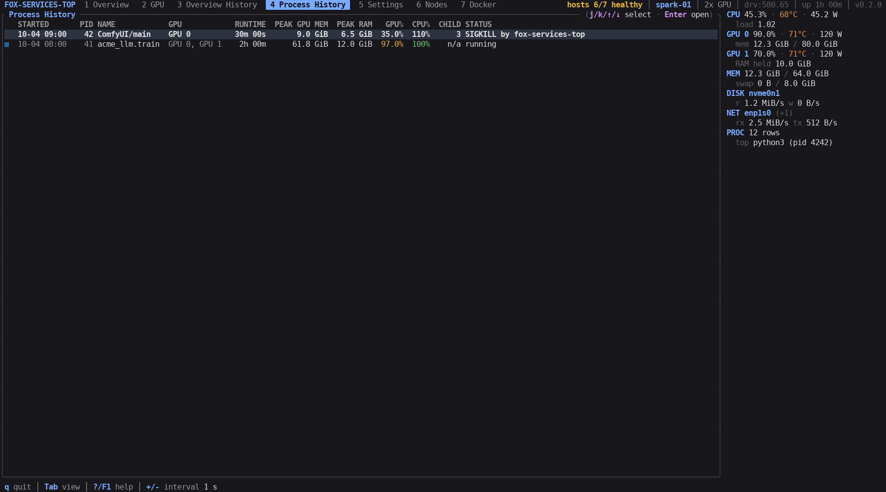
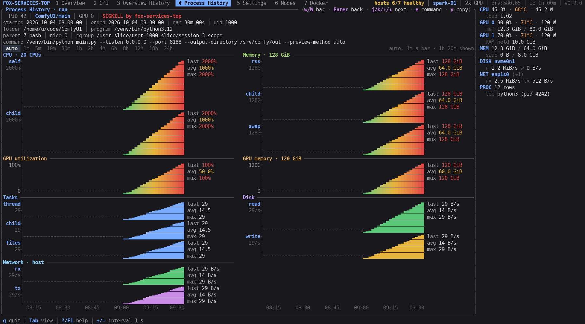
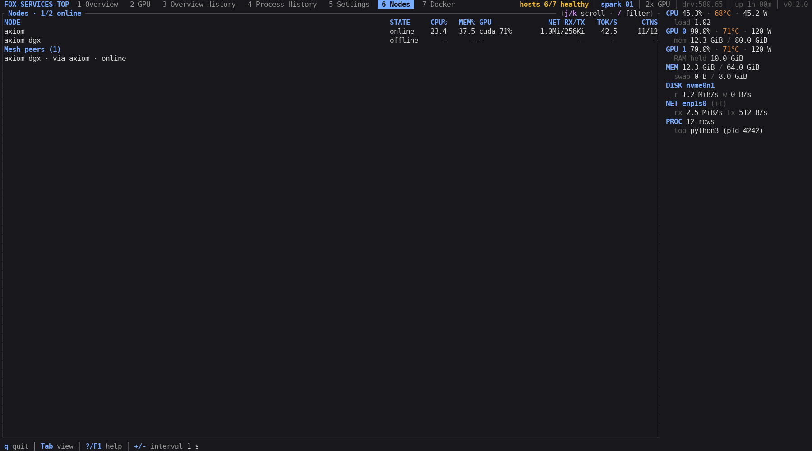
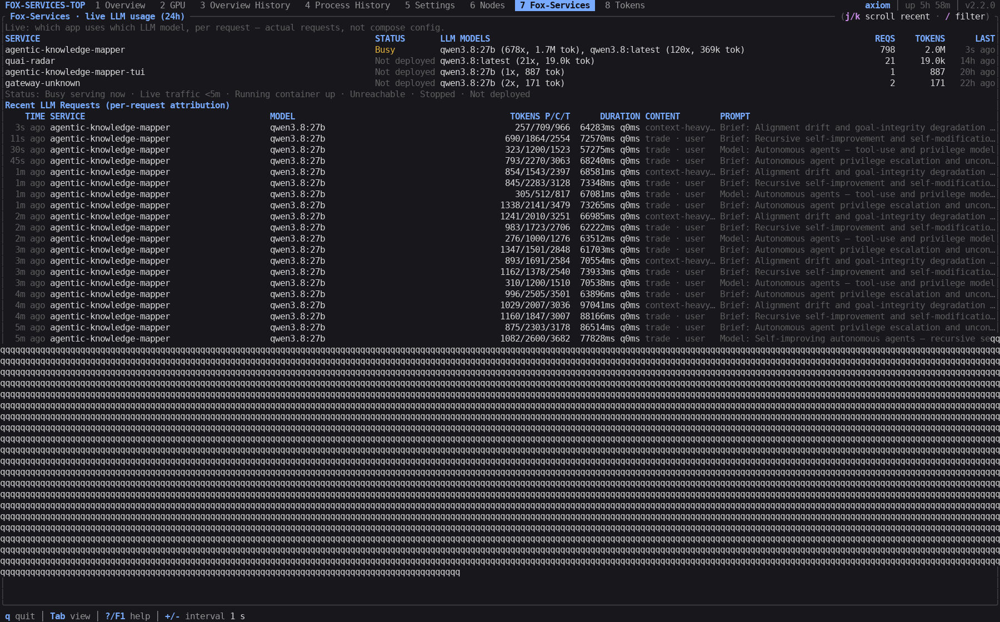
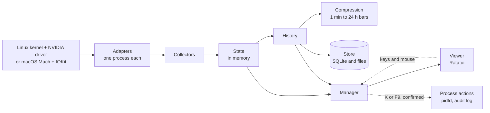

<div align="center">

# fox-services-top

**A terminal monitor for NVIDIA GPUs on Linux and DGX Spark — and for Apple
Silicon on macOS**

Every GPU, each job's share of its memory and the whole machine on one screen,<br>
plus a record of every GPU job from start to end, including how it ended.

[Project page](https://harishgovardhandamodar.me/en/projects/tools/fox-services-top/) · [How it works](https://harishgovardhandamodar.me/en/projects/tools/fox-services-top/#architecture)

[](https://github.com/harishgovardhandamodar/FoxServicesTop/releases/latest)
[](LICENSE)
[](rust-toolchain.toml)
[](https://github.com/harishgovardhandamodar/FoxServicesTop/actions/workflows/ci.yml)



<sub>Overview on a DGX Spark. The GB10 shares memory with the CPU, so the RAM bar shows the system's share and each GPU process's share in its own color.</sub>

</div>

## Install

```bash
curl -fsSL https://raw.githubusercontent.com/harishgovardhandamodar/FoxServicesTop/master/install.sh | bash
```

Linux on x86_64 or aarch64 with glibc 2.34 or newer (Ubuntu 22.04, Debian 12, RHEL 9 and later),
DGX Spark included; and macOS on Apple Silicon (arm64). WSL 2 runs the Linux build.
GPU metrics need the NVIDIA driver on Linux (without it, CPU, memory, disks and
network still work); on macOS the Apple GPU is read through IOKit with no driver
or privileges needed. WSL 1, musl, Intel macOS and Windows are not supported.

The installer picks the build for your CPU, checks it against the release's `SHA256SUMS` and
installs it to `~/.local/bin`. The previous version is kept, and `./install.sh --rollback` brings
it back. For a specific release, append `-s -- --version v2.2.0` to `bash`.

### On macOS (Apple Silicon)

`install.sh` works once a release ships a macOS build (the
`aarch64-apple-darwin` asset rides the same tag as the Linux builds). Until
then, build from source — Rust 1.92.0 (pinned by `rust-toolchain.toml`) with
Xcode command line tools for the linker (`xcode-select --install`):

```bash
git clone https://github.com/harishgovardhandamodar/FoxServicesTop.git
cd FoxServicesTop
cargo build --release --locked
./target/release/fox-services-top
```

Or in one command, including the headless collector's launchd agent
(`--service` registers it to start at login; `--install-rust` adds rustup
first if `cargo` is missing):

```bash
./install-from-source.sh --service
```

Check it with `fox-services-top --diagnostics-json`: the report shows
`"adapter_id": "macos"` healthy and `"target": "aarch64-apple-darwin"`.
CPU frequency, temperature and power stay unsupported there (they need
`powermetrics` as root), and per-process GPU memory is not exposed by macOS
without root — both are reported as unsupported, never as zeros.



<sub>Overview on Apple Silicon. The M2 Max shares memory with the CPU, so the RAM bar shows the system and GPU shares; temperature, clocks and power stay `unavailable` without root, and the GPU process table stays empty without per-process GPU counters.</sub>

### On Linux, or by hand

`install-from-source.sh` also builds from a checkout in one command
(`--service` installs the headless collector's systemd user unit,
`--install-rust` adds rustup first):

```bash
curl -fsSL https://raw.githubusercontent.com/harishgovardhandamodar/FoxServicesTop/master/install-from-source.sh | bash
```

Or by hand:

```bash
git clone https://github.com/harishgovardhandamodar/FoxServicesTop.git
cd FoxServicesTop
cargo build --release --locked
./target/release/fox-services-top
```

New here? Start with the [User Guide](docs/USER_GUIDE.md): running it, all seven
tabs, and pointing the Nodes and Fox-Services tabs at your own fox-services nodes.

## Features

htop centers on the CPU, and nvtop and nvidia-smi show GPUs only while you watch. fox-services-top puts the
GPUs first, shows which job holds how much of their memory, and keeps a record of every GPU job and
of the whole machine.

- **Every GPU at a glance.** Utilization, memory, temperature, power, clocks and fans for each GPU,
  with live charts. Gauges, chart columns and temperatures shade in 100 steps from green at 0 %
  through amber at 50 % to red at 100 % (a temperature on a 0–100 °C scale).
- **Memory by process.** The eight processes holding the most GPU memory each get a color, the same
  in the memory bars, the charts and the process table, so you see which job holds how much. The
  color comes from the process name, so a job keeps it when the job or fox-services-top restarts, unless another listed process already has it.
- **Named by what they run.** `python -m vllm.entrypoints.openai.api_server` shows as
  `vllm.api_server`, and `python main.py` in a `ComfyUI` folder as `ComfyUI/main`, not as
  `python3`.
- **GPU processes.** Every process using a GPU, with its GPU, type (compute or graphics), GPU use,
  GPU memory, CPU and RAM. Sort by any column, filter by GPU or name, and stop a process with `K`
  (SIGTERM) or `F9` (SIGKILL) after a confirmation.
- **Process History.** Every GPU process is recorded as a run, from start to end: its runtime, peak
  GPU memory and RAM, GPU and CPU use, and how it ended: exited with a code, killed by a signal,
  stopped from fox-services-top, most likely the OOM killer, or still running. Open a run for its full
  command line, working folder and charts of its CPU, memory, GPU, threads, open files, disk and
  network.
- **Overview History.** CPU, memory, each GPU's utilization, memory, temperature and power, disks
  and network as bars of 1 minute to 24 hours on the local clock, with now, average and maximum on
  every chart, and each GPU's averages, peaks and energy. Where the CPU's power can be read, the
  power charts start with the total of the CPU and the GPUs and the CPU's own, each with its energy.
- **Runs in the background.** `fox-services-top --daemon` collects and saves with no window open,
  and a user service starts it with the machine: a systemd unit on Linux
  (`packaging/systemd/fox-services-top.service`), a launchd agent on macOS
  (`packaging/macos/me.harishgovardhandamodar.fox-services-top.plist`).
  A plain `fox-services-top` then attaches to it
  for the live data and the full history; quitting the viewer leaves the collector running, so the
  record covers the whole time the service runs. Full walkthrough:
  [docs/COLLECTOR.md](docs/COLLECTOR.md).
- **Full GPU details.** One GPU at a time:
  - performance state, throttle reasons and how long it was throttled, clocks;
  - memory and the memory bus, PCIe link and traffic, NVLink-C2C;
  - thermal limits, fans, power limits and energy;
  - CUDA, driver, NVML and Linux kernel versions;
  - device, PCI and firmware, NUMA and CPU affinity, P2P paths.

  A value the GPU does not report gets no row.
- **The whole machine.** CPU usage per core, CPU temperature and power and the current and maximum
  frequency of each kind of core; memory, swap, buffers and cache; disks with free space, IOPS,
  latency and drive temperature; network throughput, errors and drops. Where the CPU's power can be
  read (powercap, or the GB10's power sensors), the header shows what the CPU and the GPUs draw
  together; that is not the power at the wall socket, and it is left out while a part cannot be
  read.
- **Made for DGX Spark.** On the GB10's unified memory, the RAM bar splits into the system's share
  and each GPU job's share. fox-services-top also reads the GB10's CPU cluster temperatures and its
  NVLink-C2C links, and ships a native aarch64 build.
- **At home on Apple Silicon.** The macOS build reads the same machine through native APIs:
  per-cluster CPU times from Mach, unified memory, per-process CPU and memory, disks, network
  and the Apple GPU's utilization and unified-memory share from IOKit — no driver, no root.
  CPU frequency, temperature and power need `powermetrics` as root and stay unsupported
  with an explicit reason instead of a fake zero; per-process GPU memory is not exposed
  by macOS without root, so the GPU process table stays empty there.
- **Settings in the app.** Change the sampling interval and the display modules, and see each data
  source's state. Every setting shows its saved and effective value, where it came from, and
  whether it applies now or after a restart.
- **Nodes across the LAN.** The Nodes tab polls every configured fox-services node over its HTTP
  API (`axiom` and `axiom-dgx` out of the box): online state, CPU, memory, GPU, network and token
  throughput per node, plus the Fox Mesh peers the nodes report. A node that does not answer keeps
  its row with the error.
- **Fox-Services everywhere.** The Fox-Services tab shows which app uses which LLM model,
  per request — live request and token counts plus the newest requests with attribution.
  Read-only; it only watches.

## Screens

### Overview

Every GPU with its utilization and memory, the CPU, memory, busiest disks and network interfaces,
and the GPU processes in their colors. The process panel has a clickable `Fox services` sub-tab
showing the Fox-Services tables in place. `c` expands the CPU into per-core bars and sensors.


### GPU

One GPU at a time: four live bars, then everything the driver reports. `h` / `l` switches between
GPUs.





<sub>GB10 with unified memory and NVLink-C2C (top); RTX 5080 with VRAM and PCIe Gen5 (bottom). Serial numbers and UUIDs are masked.</sub>

### Overview History

The machine's resources as bars of 1 minute to 24 hours (`w` / `W`), with now, average and maximum
on every chart, and each GPU's averages and peaks below.



### Process History

Every GPU process as a run, newest first: when it started, how long it ran, its peak GPU memory and
RAM, and how it ended. `Enter` opens a run with its command line (`e` shows all of it, `y` copies
it), working folder and charts.





<sub>The run's folder, program, cgroup and command line are masked.</sub>

### Nodes

Every configured fox-services node in one table: reachability, CPU and memory, GPU kind and use,
network rates, token throughput and container counts, then the Fox Mesh peers the nodes discovered.
Press `6`.



### Fox-Services

Which app uses which LLM model, per request — service statuses with real request and token
counts, then the newest requests with attribution. `/` filters by service or model; `j` / `k`
scroll the recent requests. Press `7`.



## Capabilities

- **Several GPUs per machine.** Tested on a DGX Spark (GB10), on a workstation with an RTX 5080
  and an RTX 3060, and on Apple Silicon (M2 Max), where the one Apple GPU reports utilization
  and unified memory through IOKit.
- **History that lasts.** History is saved on disk and survives restarts and reboots, with no age
  limit: each bar size keeps its latest 300 bars, so 1-minute bars cover the last 5 hours and
  24-hour bars about 10 months. Process History lists the latest 512 runs. fox-services-top records while it
  runs.
- **Light.** Written in Rust. It draws new data 4 times a second by default and keeps its data within
  a fixed 256 MiB.
- **Any terminal size.** Wide, single-column and compact layouts, down to 40×10. Keyboard and mouse,
  and four color themes.
- **Private.** No network access and no telemetry. Settings and history are files only you can
  read. Process History keeps the command lines, working folders and programs of GPU processes;
  environments are never stored.
- **Safe process actions.** Only your own processes, never from a root session, and only after a
  confirmation that expires. Signals go through a pidfd, so a reused PID is never hit, and every
  action is logged. `--read-only` turns them off.
- **Safe upgrades.** The installer verifies every download and keeps the previous version for a
  one-command rollback.

## Architecture

fox-services-top is one program. Adapters read the hardware in their own background processes, the readings
flow down the data path, and the Manager turns them into the views the screen draws.



| Component | What it does |
|---|---|
| Adapters | Read the hardware: `/proc`, hwmon, thermal zones, powercap, NVML for the GPUs, network and filesystems, each in its own background process. A read-only probe follows each GPU process. |
| Collectors | Turn raw readings into metrics: units, the best source for each value, rates from counters, one record per process. |
| State | Holds the live snapshot and the short trends, in memory only. |
| History | Keeps the Overview History and the Process History, and decides what is kept and what goes. |
| Compression | Merges samples into bars from 1 minute to 24 hours, aligned to the local clock. |
| Store | Reads and writes the SQLite databases and files, only as it is asked. |
| Manager | Schedules sampling, applies settings, checks commands and process actions, and builds the views. It keeps no data itself. |
| Viewer | Draws the screens with Ratatui from the Manager's views, and turns keys and mouse clicks into commands. |
| Runtime | Supervises the adapter processes, their IPC and bounded queues, the log and the terminal. |

The [technical deep dive](https://harishgovardhandamodar.me/en/projects/tools/fox-services-top/#architecture) on the project page
follows one sample from the kernel to the screen, then explains the adapter processes, source selection,
tiered history, Process History, GPU memory colors, safe process actions, limits and overload, and the
files on disk, each with a diagram.

<details>
<summary>Code layout</summary>

The code is a Rust workspace of eleven crates around one shared contract crate.

| Crate | Contains |
|---|---|
| `fox-services-top` | The program: command line, modes, startup and wiring |
| `fox-services-top-core` | Shared types: metrics, commands, views and the interfaces between components |
| `fox-services-top-runtime` | Background processes, IPC, queues, the log, the terminal and the time zone |
| `fox-services-top-adapters` | Linux: procfs, hwmon, thermal, powercap, NVML, network, filesystems, the process probe and process actions; macOS: one native adapter (sysctl, Mach, sysinfo, IOKit) |
| `fox-services-top-collectors` | Metrics from readings: rates, source selection and process records |
| `fox-services-top-state` | The live snapshot and the short trends |
| `fox-services-top-history` | Overview History, Process History and what each keeps |
| `fox-services-top-compression` | Bars from 1 minute to 24 hours |
| `fox-services-top-store` | SQLite databases and files |
| `fox-services-top-manager` | Scheduling, settings, sessions, process actions and views |
| `fox-services-top-ui` | Screens, widgets and the key map |

</details>

## Usage

```bash
fox-services-top                       # live monitor
fox-services-top -i 0.5                # sample every 0.5 s for this run (saved settings are not changed)
fox-services-top -t amber              # color theme for this run: dark, cyan, green or amber
fox-services-top --no-gpu              # no GPU telemetry for this run (NVML host on Linux, Apple GPU groups on macOS)
fox-services-top --read-only           # no process actions
fox-services-top --no-remote             # no fox-services-top node polling for this run
fox-services-top --remote-node axiom=http://192.168.1.63:8210   # poll only this node for this run (repeatable)
fox-services-top --daemon               # headless collector; a plain run attaches to it over a local socket
fox-services-top --replay fixture.json # simulated data only, read-only, separate temporary state
fox-services-top --check-config        # validate the configuration and print its saved and effective values
fox-services-top --diagnostics-json    # versions, SQLite, capabilities and health as JSON
fox-services-top --import-legacy ~/.config/fox-services-top/config.json --dry-run   # show the v1 → v2 mapping
fox-services-top --version --verbose   # version, commit, toolchain, target, SQLite runtime
```

**CPU power and total power:** run fox-services-top with `sudo` to read CPU power counters that require
root access. Linux powercap/RAPL energy counters are usually root-only; without access, CPU
power and the CPU + GPU total stay hidden even when GPU power is available.

```bash
sudo -H "$HOME/.local/bin/fox-services-top"  # installed with the installer above
sudo -H ./target/release/fox-services-top   # built from source; run from the repository directory
```

The hardware and driver must still expose CPU power data, and every GPU must report its power
for the total to appear. `sudo` cannot provide missing sensors. With default paths, these commands
use root's configuration and history. Process termination (`K` / `F9`) is disabled in root sessions.

`--config` and `--state-dir` take absolute paths for the configuration file and the state
directory. Command-line values override saved settings only for the current run.

Each panel names its own keys at the right of its title; the footer keeps the global ones.

| Key | Action |
|---|---|
| `1`–`7`, `Tab`, `Shift-Tab` | Overview, GPU, Overview History, Process History, Settings, Nodes, Docker |
| `q`, `Ctrl-C` | Quit (`q` is text while typing a filter; `Ctrl-C` always quits) |
| `?`, `F1` | Help |
| `+` / `-` | Faster / slower sampling |
| `j`/`k`, arrows, `PgUp`/`PgDn`, `Home`/`End` | Move the selection (scroll on the Nodes and Fox-Services tabs) |
| `c` | Show or hide the CPU sensors and per-core bars (or click the CPU panel) |
| `[` / `]` | Scroll the GPU processes of the memory panel |
| `s` / `r` | Next sort column / reverse order |
| `g` | Cycle the GPU filter (all GPUs → each GPU) |
| `/` | Filter processes by name (`Enter` applies, `Esc` clears; on Nodes/Docker it narrows their tables) |
| `K` / `F9` | Stop the selected process with SIGTERM / SIGKILL (asks for confirmation) |
| `y`/`Enter`, `n`/`Esc` | Confirm / cancel a pending process action |
| `h`/`l`, `←`/`→` | Previous / next GPU in the GPU view |
| `w`/`W`, `→`/`←` | Next / previous bar size in the history views |
| `Enter` | Open or close the selected run in Process History |
| `e` / `y` | Show the whole command line of the opened run / copy it (OSC 52) |
| `Space` | Turn the selected display module on or off in Settings |

## Configuration and files

| Purpose | Location |
|---|---|
| Configuration | `$XDG_CONFIG_HOME/fox-services-top/v2/config.json` (`~/.config/fox-services-top/v2/config.json`) |
| Overview History: every bar size (about 40 MiB) | `$XDG_STATE_HOME/fox-services-top/v2/history_tiers.sqlite3` (`~/.local/state/...`) |
| Overview History: recent minutes (7 days, at most 1 GiB) | `$XDG_STATE_HOME/fox-services-top/v2/history.sqlite3` |
| Process History (about 40 MiB) | `$XDG_STATE_HOME/fox-services-top/v2/process_history.sqlite3` and `process_recent.json` |
| Log of process actions (30 days) | `$XDG_STATE_HOME/fox-services-top/v2/audit.sqlite3` |
| Log file and instance lock | `$XDG_STATE_HOME/fox-services-top/v2/fox-services-top.log`, `instance.lock` |
| Collector attach socket | `$XDG_STATE_HOME/fox-services-top/v2/attach.sock` (a `--daemon` collector) |

Directories are created `0700` and files `0600`. When a database is full, the oldest data gives way
first: in Process History, the ended runs seen longest ago. A database from a version with another
format is started empty instead of migrated; `config.json` is always kept. Upgrading from v1 never
modifies `~/.config/fox-services-top/config.json`: review the mapping with `--import-legacy <path> --dry-run`,
then write the v2 file with `--apply`.

Remote monitoring lives in the `remote` section of `config.json` (changing it needs a restart):

```json
"remote": {
  "enabled": true,
  "poll_interval_ms": 5000,
  "timeout_ms": 4000,
  "discover_mesh": true,
  "nodes": [
    {"name": "axiom", "base_url": "http://192.168.1.63:8210"},
    {"name": "axiom-dgx", "base_url": "http://192.168.1.200:8210"}
  ]
}
```

At most 16 nodes, polled in order over plain HTTP. A node is only read: the poller calls
`/api/hardware/status`, `/api/llm/live-map`, `/api/usage/history`, `/api/ollama/stats`,
`/api/docker/projects` and, with `discover_mesh`, `/api/mesh/peers`. Polling runs on its own
thread; when a node is slow or gone, its tab row says so and the local monitor is unaffected.

## License

Apache-2.0. See [LICENSE](LICENSE).
